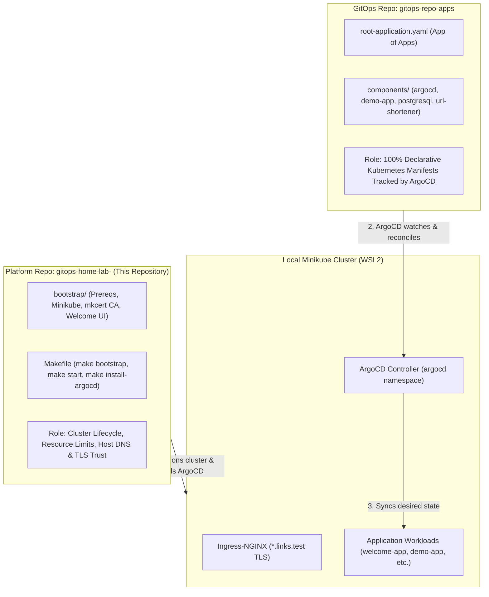

# Local DevOps Engineering Lab

A reproducible, production-modeled Kubernetes engineering platform running on **Minikube (WSL2 Ubuntu)** with Ingress-NGINX and trusted local wildcard TLS. Built to model enterprise GitOps workflows locally without incurring cloud costs.

---

## Architecture: Two-Repository Pattern

This lab implements an industry-standard separation of concerns between cluster provisioning and declarative application delivery:



* **Platform Repository ([`gitops-home-lab-`](https://github.com/vmalani27/gitops-home-lab-))**: Handles cluster boot, memory/CPU ceilings, `mkcert` certificate generation, Windows Root CA trust injection, and ArgoCD installation.
* **GitOps State Repository ([`gitops-repo-apps`](https://github.com/vmalani27/gitops-repo-apps))**: The single source of truth for all Kubernetes applications and database workloads. ArgoCD reconciles the cluster to match this repository.

---

## Prerequisites

Before starting, ensure you have:

1. **Host Environment**:
   * Windows 11 with **WSL2 (Ubuntu 22.04 LTS)**, or native Linux (Ubuntu/Debian).
2. **Hardware Constraints (Recommended for 16 GB RAM hosts)**:
   * Copy `bootstrap/wslconfig.example` to `%USERPROFILE%\.wslconfig` on Windows to cap WSL2 at 6 GB RAM and 4 vCPUs.
3. **Core Tools**:
   * Git and `make` (the bootstrap script automatically installs Docker, Minikube, Kubectl, Helm, and `mkcert`).

---

## Quickstart (From Zero to Running Lab)

### 1. Clone the Platform Repository
```bash
git clone https://github.com/vmalani27/gitops-home-lab-.git
cd gitops-home-lab-
```

### 2. Configure Local DNS (Hosts File)
To allow your browser to resolve local domains, add this line to your hosts file:

* **Windows**: `C:\Windows\System32\drivers\etc\hosts` (open as Administrator)
* **Linux / WSL2**: `/etc/hosts`

```text
127.0.0.1  links.test argo.links.test demo.links.test
```

### 3. Bootstrap the Cluster
From your WSL2 / Linux terminal, run:
```bash
make bootstrap
```
This single target:
1. Installs missing prerequisites (`docker`, `minikube`, `kubectl`, `helm`, `mkcert`).
2. Starts Minikube with strict resource caps (3 vCPUs, 4096 MB RAM, Docker driver) and enables `ingress` and `storage-provisioner` addons.
3. Generates trusted wildcard certificates via `mkcert` (`*.links.test`), provisions Kubernetes TLS secrets, and **automatically installs the public root CA into the Windows Root Certificate Store** via `certutil.exe`.
4. Deploys the onboarding welcome application.
5. Syncs the cluster `kubeconfig` to your Windows host profile (`%USERPROFILE%\.kube\config`) so tools like VS Code, k9s, and Lens work immediately from Windows.

### 4. Install ArgoCD & Apply Root App
```bash
make install-argocd
make apply-root-app
```
* Installs ArgoCD v2.13.3 patched with `--insecure` (allowing Ingress-NGINX to terminate TLS without redirect loops).
* Deploys Ingress for `https://argo.links.test`.
* Configures the Root "App of Apps" controller watching [`gitops-repo-apps`](https://github.com/vmalani27/gitops-repo-apps).

---

## Accessing Services

Because Minikube runs inside the WSL2 Docker bridge, forward ingress traffic to your host:

```bash
make ingress-forward
```
*(Alternatively, run `minikube tunnel` in a dedicated terminal).*

| Service | URL | Notes |
|---|---|---|
| **Welcome App** | [https://links.test](https://links.test) | Cluster baseline & verification page. |
| **ArgoCD Dashboard** | [https://argo.links.test](https://argo.links.test) | Username: `admin`. Run `make argocd-pass` for password. |
| **Demo App** | [http://demo.links.test](http://demo.links.test) | Sample Apache HTTPD service managed via GitOps. |

---

## Common Commands

| Command | Purpose |
|---|---|
| `make bootstrap` | Full cluster bootstrap (prereqs, minikube, certs, welcome app, kubeconfig sync). |
| `make start` | Starts an existing Minikube cluster with tuned specs. |
| `make install-argocd` | Installs ArgoCD with Ingress and waits for deployment rollout. |
| `make argocd-pass` | Prints the initial admin password for ArgoCD. |
| `make apply-root-app` | Applies the root "App of Apps" manifest tracking `gitops-repo-apps`. |
| `make ingress-forward` | Forwards ingress controller to `localhost:80` and `localhost:443`. |
| `make status` | Shows Minikube health, nodes, and all running pods across namespaces. |
| `make sync-kubeconfig` | Re-syncs cluster credentials to `%USERPROFILE%\.kube\config`. |
| `make stop` | Gracefully stops the Minikube cluster. |
| `make clean` | Destroys the Minikube cluster and disk storage. |

---

## How to Test GitOps (Push-to-Deploy)

1. Clone or open the companion repository:
   ```bash
   git clone https://github.com/vmalani27/gitops-repo-apps.git
   ```
2. Make a declarative change in `gitops-repo-apps` (e.g., update `components/demo-app/manifests.yaml` or add a new component).
3. Commit and push to `main`:
   ```bash
   git add . && git commit -m "feat: update demo app" && git push origin main
   ```
4. Open the ArgoCD dashboard at **[https://argo.links.test](https://argo.links.test)**. ArgoCD will automatically detect the commit and sync your cluster state.

---

## Security & Secrets Policy

* No TLS private keys, certificates, or secrets are tracked in Git (enforced via `.gitignore` and `.gitattributes`).
* All certificates are generated ephemerally via `mkcert` and injected directly into cluster memory as Kubernetes secrets.
