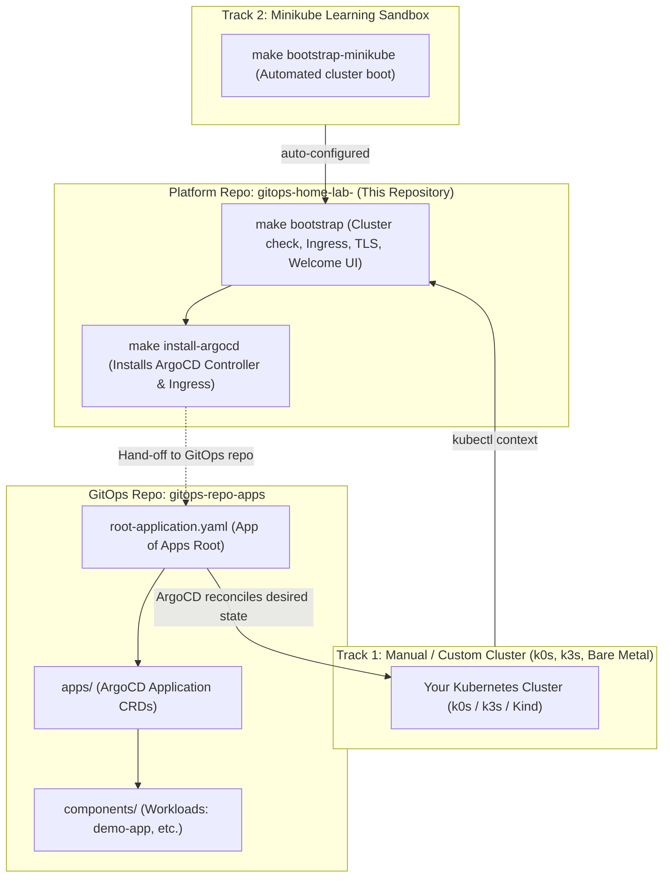

# Local DevOps Engineering Lab

A reproducible, production-modeled Kubernetes engineering platform that can bootstrap onto **any Kubernetes cluster** (such as manually installed **k0s**, **k3s**, or native nodes) or spin up an automated **Minikube** sandbox. Built with Ingress-NGINX, trusted local wildcard TLS (`mkcert`), and enterprise GitOps (ArgoCD).

---

## Architecture: Two-Repository Pattern

This lab implements an industry-standard separation of concerns between cluster provisioning and declarative application delivery:



* **Platform Repository ([`gitops-home-lab-`](https://github.com/vmalani27/gitops-home-lab-))**: Handles cluster verification, Ingress-NGINX controller check, `mkcert` wildcard TLS generation, Windows Root CA trust injection, and ArgoCD installation.
* **GitOps State Repository ([`gitops-repo-apps`](https://github.com/vmalani27/gitops-repo-apps))**: The single source of truth for all Kubernetes applications and database workloads. ArgoCD reconciles the cluster to match this repository.

---

## Choosing Your Learning Track

### Track 1: Bring Your Own Cluster (k0s, k3s, Kind, Bare Metal)

Use this track if you want to learn how to manually install and configure **k0s** or **k3s**.

#### 1. Install client tools (optional helper)
If you need `kubectl`, `helm`, and `mkcert` installed in Ubuntu / WSL2:
```bash
make install-tools
```

#### 2. Manually Start Your Cluster & Point Kubeconfig
* **For k0s**:
  ```bash
  # Install k0s binary
  curl -sSLf https://get.k0s.sh | sudo sh

  # Start k0s single-node controller & worker
  sudo k0s install controller --single
  sudo k0s start

  # Configure kubeconfig for your user
  mkdir -p ~/.kube
  sudo k0s kubeconfig admin > ~/.kube/config
  chmod 600 ~/.kube/config
  ```

* **For k3s**:
  ```bash
  # Install k3s (with traefik disabled if you prefer ingress-nginx)
  curl -sfL https://get.k3s.io | INSTALL_K3S_EXEC="--disable=traefik" sh -

  # Configure kubeconfig for your user
  mkdir -p ~/.kube
  sudo cp /etc/rancher/k3s/k3s.yaml ~/.kube/config
  sudo chown $USER:$USER ~/.kube/config
  ```

#### 3. Bootstrap the GitOps Platform
Once `kubectl` is pointing to your cluster, run:
```bash
make bootstrap
```
This command:
1. **Verifies cluster connectivity** (`make check-cluster`).
2. **Ensures Ingress-NGINX is present** (`make install-ingress`).
3. **Provisions trusted wildcard TLS certs** (`*.links.test`) and installs the CA in Windows/host trust store (`make certs`).
4. **Deploys onboarding test application** (`make welcome`).
5. **Syncs Kubeconfig** to `%USERPROFILE%\.kube\config` for Windows IDEs/tools (`make sync-kubeconfig`).

---

### Track 2: Learn with Minikube Sandbox (Zero-to-Cluster)

If you just want a 1-command sandbox without installing a cluster manually:
```bash
make bootstrap-minikube
```
This automatically installs Minikube & Docker (if missing), starts Minikube with tuned resources and ingress addons, and executes the full bootstrap.

---

## Finishing Setup: Deploy ArgoCD & GitOps

Once bootstrapped (via Track 1 or Track 2):

### 1. Configure Local DNS (Hosts File)
Add the following entry to your hosts file:
* **Windows**: `C:\Windows\System32\drivers\etc\hosts` (open as Administrator)
* **Linux / WSL2**: `/etc/hosts`

```text
127.0.0.1  links.test argo.links.test demo.links.test
```

### 2. Install ArgoCD
```bash
make install-argocd
```
* Installs ArgoCD v2.13.3 patched with `--insecure` for clean Ingress-NGINX TLS termination.
* Configures `https://argo.links.test`.
* Run `make argocd-pass` to retrieve your admin credentials.

### 3. Hand-off to GitOps (Deploy Applications)
Now that cluster platform bootstrapping is complete, application workloads are managed from the companion GitOps repository:
```bash
git clone https://github.com/vmalani27/gitops-repo-apps.git
cd gitops-repo-apps
kubectl apply -f root-application.yaml
```
ArgoCD will immediately pick up the root application, sync all component manifests, and deploy workloads (such as `demo-app`).

---

## Accessing Services

If running in WSL2 or Docker bridge mode, forward ingress traffic:
```bash
make ingress-forward
```

| Service | URL | Notes |
|---|---|---|
| **Welcome App** | [https://links.test](https://links.test) | Cluster verification & status page. |
| **ArgoCD Dashboard** | [https://argo.links.test](https://argo.links.test) | Username: `admin`. Run `make argocd-pass` for password. |
| **Demo App** | [http://demo.links.test](http://demo.links.test) | Sample HTTP service managed via GitOps. |

---

## Make Command Reference

| Command | Track | Purpose |
|---|---|---|
| `make check-cluster` | Track 1 | Verifies connectivity to the active Kubernetes cluster. |
| `make install-ingress` | Track 1 | Detects and installs Ingress-NGINX if missing. |
| `make bootstrap` | Track 1 | Bootstraps active cluster (cluster check + ingress + TLS + welcome + sync). |
| `make install-tools` | Track 1 | Installs client CLIs only (`kubectl`, `helm`, `mkcert`). |
| `make bootstrap-minikube` | Track 2 | Automated sandbox: boots Minikube + runs full bootstrap. |
| `make minikube-start` | Track 2 | Starts Minikube cluster with tuned specs. |
| `make minikube-stop` | Track 2 | Stops Minikube cluster. |
| `make minikube-clean` | Track 2 | Destroys Minikube cluster. |
| `make install-argocd` | Shared | Installs ArgoCD with Ingress and waits for rollout. |
| `make argocd-pass` | Shared | Prints initial admin password for ArgoCD. |
| `make ingress-forward` | Shared | Forwards ingress controller to localhost `80` and `443`. |
| `make status` | Shared | Displays cluster context, nodes, and all running pods. |
| `make sync-kubeconfig` | Shared | Syncs kubeconfig from WSL2 to `%USERPROFILE%\.kube\config`. |
